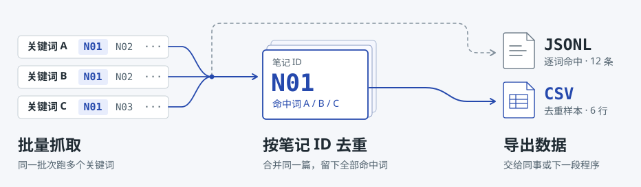

# 小红书雷达

**小红书搜索爬虫。** 按关键词批量抓取笔记，保留每篇的作者、赞藏和原帖出处。

<p><picture>
  <source media="(max-width: 660px)" srcset="docs/assets/pipeline-mobile.svg">
  
</picture></p>

**合成示例**　考研内容组的三个词依次是「考研数学真题」「考研数学错题本」「考研数学冲刺」。

[下载去重 CSV](https://github.com/ZhangShixing0/xhs-radar/raw/refs/heads/main/examples/sample-output/samples.csv)　·　[下载逐词 JSONL](https://github.com/ZhangShixing0/xhs-radar/raw/refs/heads/main/examples/sample-output/observations.jsonl)　·　[快速开始](#快速开始)

## 快速开始

**先离线跑一批。** 准备 Python 3.10 或更高版本。在包含这份 README、`scripts` 和 `examples` 的目录打开终端，运行下面一条命令。示例只用 Python 标准库和临时数据库，无需账号或采集设备。

```shell
python -B examples/replay.py --out radar-demo
```

看到 `3 queries | 12 observations | 6 distinct notes | offline` 就跑通了。示例把合成搜索记录送入雷达的导入和报告流程，在 `radar-demo` 下生成三个文件。

| 打开哪个文件 | 第一眼看什么 |
| --- | --- |
| `samples.csv` | 用 Excel 打开，一行一篇。首行 `N01` 有 1,280 个收藏，命中了三个词。 |
| `observations.jsonl` | 用文本编辑器打开，一行一次命中。搜 `"N01"` 可找到三行，分别属于三个词。 |
| `sources.html` | 用浏览器打开，按笔记 ID 核对合成标题、作者和每个词下的位置。三个文件放在一起即可回查。 |

用浏览器打开刚生成的 `radar-demo/sources.html`，找到 `N01`，就能看到它在三个词下都排第一。下一步可以[在授权设备上抓自己的关键词](#授权设备批量抓取)，也可以先[用同一篇笔记对照两种导出](#怎么用-csv-和-jsonl)。

## 授权设备批量抓取

这一段在**已有雷达部署的 Windows 设备**上运行，使用 Windows PowerShell 5.1 和有效的小红书登录。仓库提供采集代码；只读采集程序、关键词配置和中央 SQLite 历史库由设备提供。若已配置 `XHS_RADAR_ENGINE_ROOT`，沿用现值。它应指向外部设备部署目录。[设备配置与路径说明](docs/device-guide.md)

**1. 检查设备。** 在同一个 PowerShell 窗口依次运行本节命令，保留 `$device` 和 `$run` 供后面使用。

```powershell
$device = powershell.exe -NoProfile -ExecutionPolicy Bypass `
  -File .\scripts\run-radar.ps1 -Action status | ConvertFrom-Json
$device | Select-Object status, provider_present, keyword_config_present, central_database_present
```

`ready` 表示设备上的采集程序、配置和历史库都已找到。这个检查离线执行，登录状态会在真正搜索时检查。看到 `device_incomplete`，先根据值为 `False` 的字段核对设备配置。

**2. 冻结本批关键词。** 下面以通勤背包的竞品采样为例。把引号中的文字换成自己的词，每个不同的词写一个 `--keyword`。`inspect` 可以在采集前查看实际计划。

```powershell
$run = 'muse-' + [guid]::NewGuid().ToString('N')
python -B radar/radar.py plan --run $run `
  --keyword "通勤背包" --keyword "电脑双肩包" --keyword "轻量通勤包" `
  --sort "最多收藏" --time-filter "一周内"
python -B radar/radar.py inspect --run $run
```

这个例子会生成 3 项查询，回执为 `operations_planned: 3`、`network_request_made: false`。`muse-` 是自选词入口要求的运行号前缀。改词时新建运行号，原批次留作复查。

**3. 开始采集，找到文件。** 确认计划后执行 `search`。这一步会使用设备的现有登录逐词搜索。

```powershell
python -B radar/radar.py search --run $run
```

看末尾回执里的 `status`、`run_directory` 和 `report_path`。`completed` 表示本次搜索完成，结果已导入中央库。`run_directory` 下是原始导出，`report_path` 指向本次 Markdown 报告。沿用上面的变量可以直接列出文件：

```powershell
$batch = Join-Path $device.engine_root "data\xhs-radar\runs\$run"
Get-ChildItem -LiteralPath $batch -Filter 'observations.*'
```

设备每天按既有词表运行时，也可在仓库根目录直接调用 `powershell.exe -NoProfile -ExecutionPolicy Bypass -File .\scripts\run-radar.ps1 -Action search`，从它自己的末尾回执读取运行号和目录。

**批次中断时**，先看 `stop_reason` 和该批的 `manifest.json`。登录失效、验证或限流时先停止；确认设备恢复、决定继续后，自选词批次用原运行号执行 `python -B radar/radar.py resume --run $run`。只想重看已有批次，执行 `python -B radar/radar.py report --run $run`。设备自带词表启动的批次使用相同的 PowerShell 包装器和 `-Action resume` 或 `-Action report`，并传入原 `-RunId`。

## 怎么用 CSV 和 JSONL

**先看一行代表什么。** 设备完成搜索时会写出 `observations.csv` 和 `observations.jsonl`，两者都是**一行一次逐词命中**。首页的 `samples.csv` 是进一步按笔记 ID 合并的表，适合交给运营筛选。

| 文件 | 适合做什么 | 主要字段 |
| --- | --- | --- |
| `samples.csv` · 一篇一行 | 在 Excel 里按收藏排序，按作者或命中词筛出待研究的笔记。全表行数就是本批独立笔记数。 | 笔记 ID、标题、作者、赞藏、合并后的命中词、取样时间、出处 |
| `observations.csv` · 一次命中一行 | 用表格对比同一批的各个词搜回了什么，检查每篇在该词下的排名。由设备搜索原生生成。 | `query_text`、`result_rank`、`feed_id`、`liked_count`、`collected_count`、`observed_at` |
| `observations.jsonl` · 一次命中一行 | 给脚本逐行读取，复核命中来源、排名，以及实际使用的筛选条件。 | 设备记录还含 `author_id`、`canonical_url`、`fallback_used` 等字段 |

### 按笔记 ID 去重解决什么问题？

拿 N01 对一次数。合成样本的三条命中都记录了 936 赞、1,280 收藏。按笔记整理时，收藏仍是 1,280。保留三行原始记录，才能看清它分别被哪些词搜到。先跑完快速开始，再在 PowerShell 里试：

```powershell
Get-Content -Encoding UTF8 .\radar-demo\observations.jsonl |
  ForEach-Object { $_ | ConvertFrom-Json } |
  Where-Object feed_id -eq 'N01' |
  Select-Object query_text, result_rank, collected_count
```

要看收藏最高的三篇，读去重表即可。按数值排序能正确处理四位数和三位数的收藏。

```powershell
Import-Csv -Encoding UTF8 .\radar-demo\samples.csv |
  Sort-Object { [int]$_.'收藏' } -Descending |
  Select-Object -First 3 标题, 作者, 收藏
```

**从自己的设备批次生成去重 CSV。** 用上节的 `$batch`，将一批原始 JSONL 整理成一个新文件。导出示例保留全部命中词，作者、标题和赞藏取自该笔记在本批最后一次观测。运行时请指定新的 CSV 文件名。

```powershell
python -B examples/export_batch.py "$batch\observations.jsonl" "$batch\samples.csv"
```

真实搜索用 `canonical_url` 回到对应的小红书笔记；离线样本用 `example_source` 指向本地模拟出处。`observed_at` 是**取样时间**。若 `fallback_used` 为真，解释结果时看该行实际使用的 `sort_mode`、`time_filter`。搜索卡片未显示的互动数可在设备 JSONL 中结合原始显示值核对。

## 共享采样历史与数据隐私

S2 和考研项目各自决定搜什么。指向同一授权设备的中央库时，同一笔记复用同一个身份，各批次的赞藏快照分别保存。隔周复查可以按 `feed_id` 对齐两批取样，计算赞藏差值。只在一批出现的笔记标记为首次出现或本批未见。[两批记录的合成周报](examples/weekly/README.md)

仓库提供源码、建表 SQL、合成样本和文档。真实关键词、数据库、登录会话、私有查询参数、原媒体和运行回执留在授权设备。在线第三方采集程序由设备提供，源码来源、授权和分发范围见[源码基线](SOURCES.md)。已有原帖队列核对、详情批次和断点处理见[设备使用手册](docs/device-guide.md)。

## 验证范围

离线示例实际调用仓库的 `import-run` 和 `report-run`，验证 12 条合成记录合并为 6 篇，同一批重复导入保持结果一致。设备批量搜索按现有只读入口编写；本次 README 验证了计划生成和本地检查，没有使用真实账号发起搜索或抓取详情。

```powershell
python -B -m unittest discover -s tests -v
python -B radar/test_adapter.py -v
```
