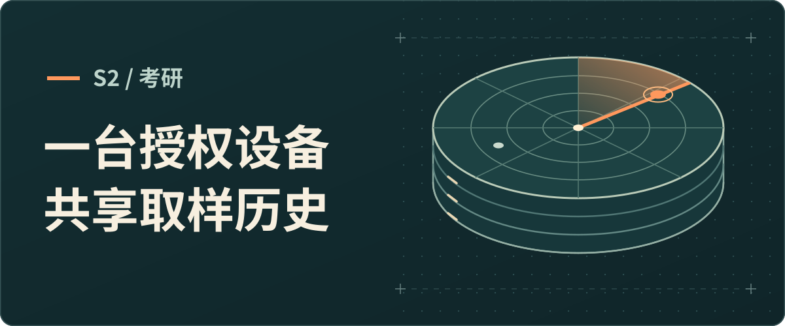

<h1 align="center">小红书雷达</h1>

<p align="center">
  
</p>

<p align="center"><strong>同一篇笔记只建一条记录，每次取样都留下当时的赞藏快照。</strong></p>

<p align="center">
  <a href="#快速开始">快速开始</a> ·
  <a href="docs/device-guide.md">设备使用手册</a> ·
  <a href="#数据与隐私">数据与隐私</a> ·
  <a href="SOURCES.md">源码来源</a>
</p>

<p align="center">
  
  
</p>

## 雷达解决什么问题

S2 和考研项目各自决定搜什么，共用 `xhs-viral-radar` 背后的只读采集器和设备上的 SQLite 历史库。假设两边先后搜到同一篇笔记，雷达会用平台和笔记 ID 找回同一条记录，再按运行号保存各次观测。回看某一批时，仍然能看到当时的赞藏数。

| 使用场景 | 从哪里开始 | 得到什么 |
| --- | --- | --- |
| S2 研究新方向 | 给出关键词，冻结本轮计划 | 带来源的搜索卡片，可选入固定原帖队列，也可保留普通样本作对照 |
| 考研筛选高收藏专题 | 用设备现有关键词配置生成周计划 | 按收藏门槛筛选的候选，以及有多位作者支持的专题 |
| 复查已有样本 | 指定原运行号和搜索回执目录 | 离线核对计划、作者、链接和卡片快照 |

## 快速开始

在克隆目录打开 PowerShell。先用[合成关键词](config/keywords.example.json)试跑，Python 标准库就能生成计划。

```powershell
$plan = Join-Path $env:TEMP ("radar-{0}.json" -f [guid]::NewGuid())
python -B scripts/xhs-radar/xhs_radar.py plan `
  --config config/keywords.example.json --plan "$plan"
```

回执中的 `operations: 2` 对应两条示例查询，`network_request_made: false` 表示本次仅生成计划。打开 `$plan` 可以查看每条查询的关键词、时间范围和排序方式。

在授权设备上，可单独查看雷达能否找到中央数据库：

```powershell
python -B radar/radar.py status
```

`central_database_present` 表示数据库文件是否存在。离线检查时，登录状态 `authentication_state` 显示为 `unknown`。生成真实周计划、检查既有队列和准备详情批次的命令见[设备使用手册](docs/device-guide.md)。

## 数据与隐私

| 进入 GitHub 私有仓库 | 留在授权设备 |
| --- | --- |
| 只读采集与报告代码、数据库建表 SQL | 账号登录会话、浏览器配置、请求使用的令牌 |
| 合成关键词、离线测试、文档与示意图 | 真实关键词、取样数据库、运行记录、私有链接参数和原媒体 |

仓库按文件名维护[发布清单](.gitignore)。在线搜索与详情读取使用设备已有授权和只读提供程序。第三方程序由设备提供，源码提取范围及许可说明见[源码基线](SOURCES.md)。

## 测试与验证

```powershell
python -B -m unittest discover -s tests -v
python -B radar/test_adapter.py -v
```

离线测试覆盖跨项目去重、重复导入、报告计数、详情断点和队列身份核对。独立发布时，还在授权设备上核对过本地状态、周计划和一条已有原帖队列记录。本次发布验证范围截至离线核对，未进行线上搜索或详情读取。
